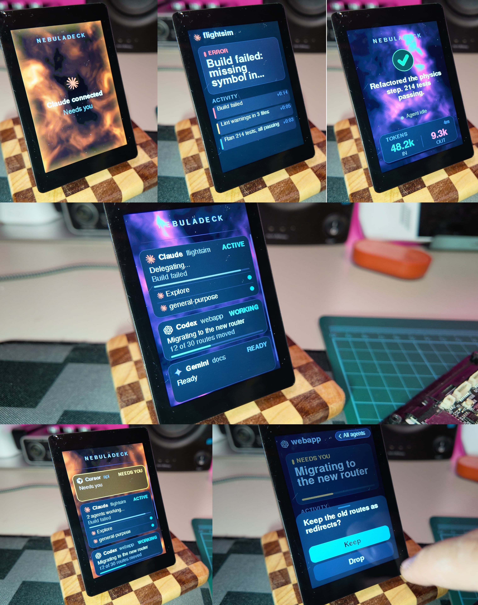
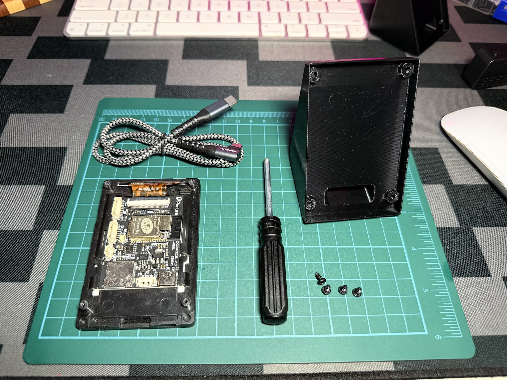
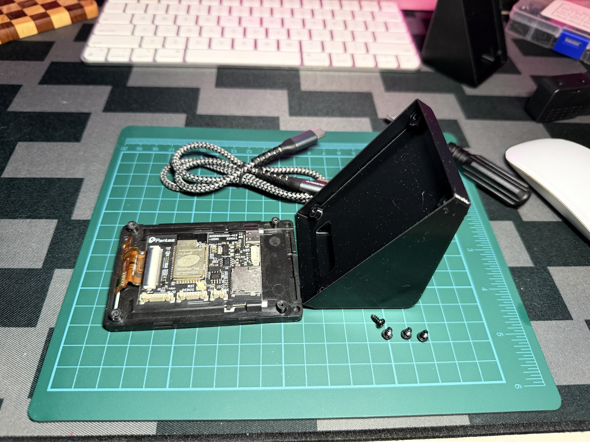
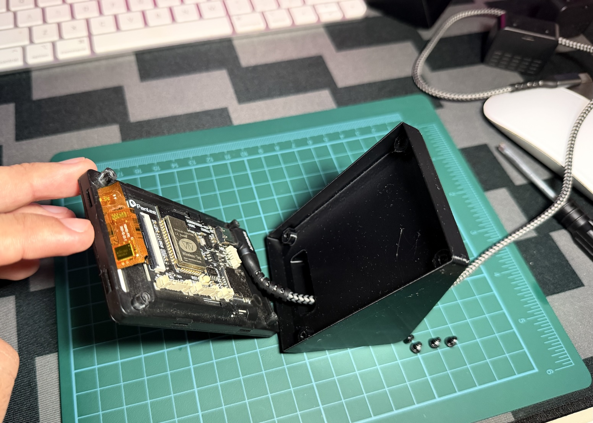
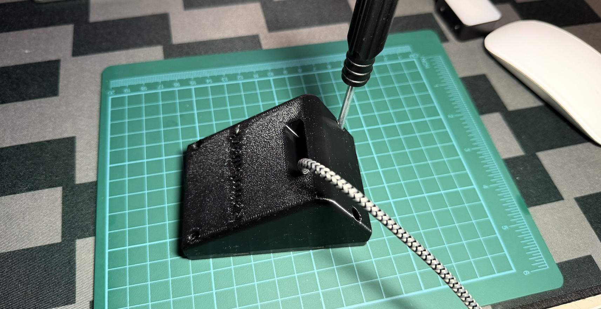
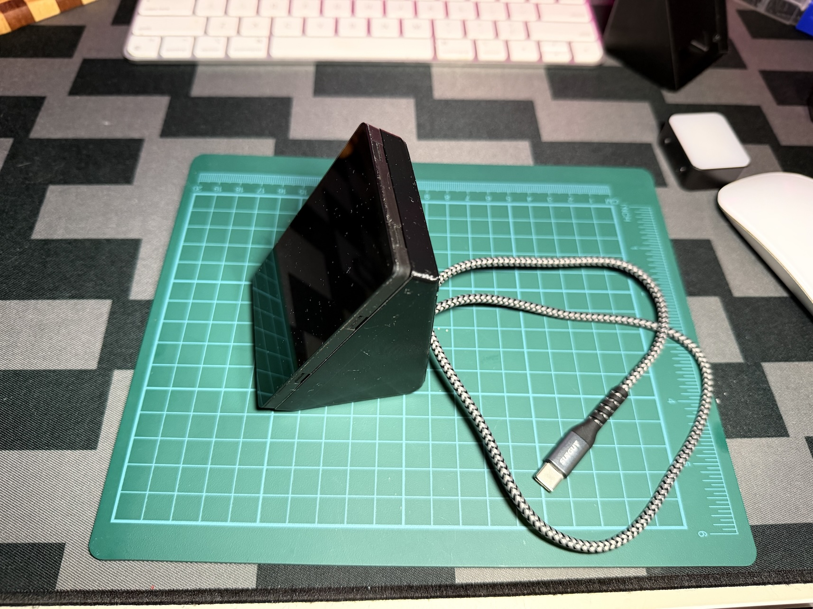

# NebulaDeck

[](https://github.com/jor3l/nebuladeck/releases/latest)
[](https://jor3l.github.io/nebuladeck/)

A small always-on touch screen on your desk that shows what your AI agents are doing, built on
the **Panlee SC01 Plus** or the original **SC01** (3.5" 320×480 capacitive touch, standing upright).

<p align="center"></p>

New here? [Build one](#build-your-nebuladeck), follow the [quick start](#quick-start), then read the
[user manual](docs/MANUAL.md) for everything the screen can do.

## Why

Coding agents (Claude Code, Codex, Gemini CLI, Cursor, Copilot...) work for minutes at a time. You either babysit the terminal or walk away
and miss the moment they need you. NebulaDeck is the glanceable middle ground:

- **See it from across the room.** What the agent is working on, how far along it is, and
  whether it finished or broke. Big type, colour-coded status, a slow nebula while it's idle.
- **Answer without going back to the keyboard.** When an agent needs a decision ("Delete 12
  files?") the question shows up as buttons. Tap one and the agent carries on.
- **Know what a task cost.** When a task ends, the screen shows a summary and its token totals.
- **Stay out of the way.** It's a separate screen, not another window or notification, so
  it never steals focus or covers your work.

## How it works

```
 Agents on your computer                         NebulaDeck (on your WiFi)
 ┌───────────────────────────┐   HTTP on your    ┌──────────────────────────┐
 │ Your coding agent +       │   local network   │ ESP32 + touch screen     │
 │ a few lines of rules      │                   │                          │
 │   └─ curl ────────────────┼──────────────────▶│ http://nebuladeck.local  │
 │                           │◀──────────────────┤ taps on ask buttons      │
 └───────────────────────────┘                   └──────────────────────────┘
```

1. **Setup.** A fresh device shows a welcome QR code. Scan it, and the setup page
   ([jor3l.github.io/nebuladeck](https://jor3l.github.io/nebuladeck/)) connects to the screen over
   **Bluetooth**, lists the WiFi networks it can see, and sends it the password you type. The
   device saves the password, joins the network and switches Bluetooth off.
2. **Talking to it.** The device serves a small JSON API on your LAN and announces itself as
   `nebuladeck.local`. Agents call it with plain `curl` (`POST /api/state`, `/api/ask`, `/api/done`),
   so nothing gets installed on your computer. A few lines in the agent's rules (AGENTS.md, GEMINI.md,
   Cursor rules, a Claude Code skill...) tell it when to update the screen. For Claude Code, optional
   hooks also show "Thinking..." and "Ready" during plain chats.
3. **Sessions.** Each command keeps the session alive. If nothing arrives for 30 minutes, or the agent
   says `bye`, the screen goes back to the idle nebula ("Agent not connected"). After 3 minutes with
   no touch and no agent activity the backlight fades off; a tap or the next agent request wakes it.
   It stays on while a question is waiting, and for up to 10 minutes while the agent needs you.
4. **Updates.** Released devices check GitHub for newer firmware every 12 hours and ask on screen
   before installing (**Update** / **Skip**).

## Privacy and safety

NebulaDeck runs entirely on your local network. There is no cloud service, no account and no
telemetry.

- **Your agents' data stays in your house.** Titles, messages, questions and token counts go
  straight from your computer to the device over your LAN and are only drawn on the screen. The
  device stores none of it, and nothing is forwarded anywhere.
- **Agents don't see each other's work.** The screen doesn't relay anything between agents or
  sessions: commands only draw, and the only thing an agent reads back is the answer to its own
  question (looked up by a random id). If several sessions share one screen, the newest command
  wins the display.
- **Hooks send event names only.** The optional Claude Code hooks tell the screen "a tool started"
  or "the turn ended". Your prompts, commands and files never leave your computer.
- **Your WiFi password goes only to the device.** The setup page is a static page. It sends the
  password over a direct Bluetooth connection from your browser to the screen and nowhere else.
  The device keeps it in its own flash.
- **The only connection outside your network is the update check.** Released firmware asks
  GitHub's public API about the newest release every 12 hours and downloads it over verified
  HTTPS when you tap Update. The request carries nothing but the firmware version. Builds you make
  yourself (`make flash`) never make it.
- **What it doesn't do:** the API has no password, so treat it like any other gadget on your LAN.
  Anyone on the same network can put text on the screen or read its basic info (firmware, WiFi
  name, IP). Use it on networks you trust. It can't run anything on your computer: the agent
  decides what to do with a tapped answer.

## Hardware

Either board works; the web flasher detects which one you plug in.

| | **SC01 Plus** (WT32-SC01 Plus) | **SC01** (WT32-SC01) |
|---|---|---|
| Chip | ESP32-S3, 16 MB flash, 8 MB PSRAM | ESP32-WROVER-B, 4 MB flash (some 16 MB), PSRAM |
| Display | 3.5" 320×480 ST7796, 8-bit parallel | 3.5" 320×480 ST7796S, SPI |
| Touch | FT6336 capacitive | FT6336 capacitive |
| USB | native USB-C | USB-serial bridge |
| Build | `sc01plus` (default) | `sc01` (`make flash BOARD=sc01`) |

The SC01 build runs on the same code but hasn't been tested on a real board yet; the SPI screen
also draws more slowly than the Plus's parallel one.

- A USB-C cable. After flashing, USB only provides power; data goes over WiFi.
- To flash an SC01 Plus over USB, it may need download mode: jumper **BOOT** to **GND** on the DEBUG header and press **RST**
  (download mode), then remove the jumper and press RST again. Later updates go over WiFi.

## Build your NebulaDeck

A printed stand turns the board into a desk screen. Print it, then put it together in about five
minutes with a screwdriver. The same guide is on the setup page:
[Build your NebulaDeck](https://jor3l.github.io/nebuladeck/#/build).

**What you need**

| Qty | Part |
|---|---|
| 1 | Panlee **SC01 Plus** or **SC01**, in its case with the back cover off |
| 4 | M3 × 5 mm self-tapping screws |
| 1 | USB-C to USB-C cable, one end right-angled |
| 1 | Printed stand: [3MF](print/nebuladeck-0.1.3mf) (print project) or [STL](print/nebuladeck-0.1.stl) |

**Assembly**

| | |
|---|---|
|  | **1. Lay out the parts.** Take the back cover off the board's case and keep the front frame on: the stand screws into the frame's four corner posts. Have the cable, the four screws and the stand ready. |
|  | **2. Line them up.** Put the board screen-down with its USB-C port towards the stand, and the stand's open side facing the board. The slot in the back of the stand lines up with the port. |
|  | **3. Plug in the cable.** Push the straight end of the cable through the slot from the inside, then plug the right-angle end into the board. Point the angled plug so the cable runs flat towards the slot. |
|  | **4. Close it and screw it down.** Fold the stand onto the back of the board, making sure no cable is pinched at the edges. Drive the four screws through the stand's corners into the posts. Snug is enough: self-tapping screws strip plastic if overtightened. |
|  | **5. Stand it up and plug it in.** Turn it upright and plug the other end into your computer or a USB charger. Then flash it (below). |

## Quick start

Everything happens on [jor3l.github.io/nebuladeck](https://jor3l.github.io/nebuladeck/):

1. **Flash device** from Chrome or Edge (choose Latest or Dev). Or from source: `make flash`.
2. **Connect to WiFi**: scan the QR code on the screen and follow the page. You need Chrome or
   Edge on Android or a computer; on iPhone use the Bluefy browser.
3. **Set up your agent**: enter the device address (or keep `nebuladeck.local`), pick your agent's
   tab (Claude Code, Codex CLI, Gemini CLI, Cursor, GitHub Copilot or any other) and copy the
   ready-made command or rules. Then try it:
   ```bash
   curl -4 -s http://nebuladeck.local/api/info
   curl -4 -s -H 'Content-Type: application/json' -d '{"status":"working","title":"Hello"}' http://nebuladeck.local/api/state
   ```

How to use the screen (questions, several agents, the logo menu, sleep, updates, troubleshooting):
[docs/MANUAL.md](docs/MANUAL.md). Full walkthrough on a Mac: [docs/SETUP-MAC.md](docs/SETUP-MAC.md).
API and Bluetooth details: [docs/PROTOCOL.md](docs/PROTOCOL.md).

Tap the **NEBULADECK** logo for device info: version, network, IP, **Check updates**,
**Forget WiFi** and **Turn screen off** (dark until you tap it; it keeps receiving updates meanwhile). Holding the screen for 5 seconds also opens WiFi setup.

## Releases

- **Dev:** every push to `main` builds `dev-<run>-<sha>` and replaces the `dev` prerelease. Devices
  flashed with Dev update to newer dev builds.
- **Latest:** the manual **release** workflow (Actions → release → version `X.Y.Z`) builds a stable
  `vX.Y.Z` and marks it latest. Devices flashed with Latest offer it on screen.
- The web flasher offers both channels.

## Layout

- `firmware/` PlatformIO + Arduino, LovyanGFX, NimBLE: screens, BLE WiFi setup, HTTP API, OTA
- `skill/` the Claude Code skill (`SKILL.md`) and optional hooks (`hooks.json`); other agents' rules are generated on the setup page
- `site/` the setup page (Bluetooth WiFi setup, web flasher, agent setup, build guide) on GitHub Pages
- `print/` the 3D-printable stand (3MF, STL) and assembly photos
- `tools/demo.sh` drives every screen with curl (`make demo`)
- `docs/MANUAL.md` user manual
- `docs/PROTOCOL.md` HTTP API and Bluetooth setup service (source of truth)

## Contributing

See [CONTRIBUTING.md](CONTRIBUTING.md). MIT licensed.
